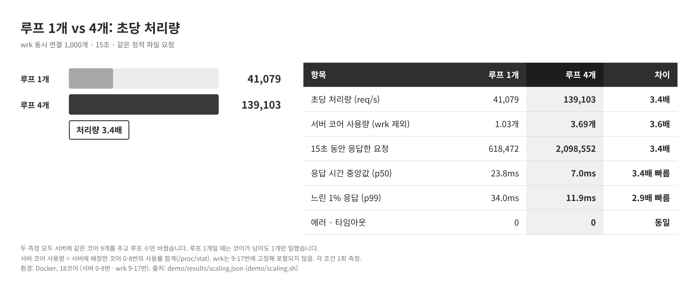

# C 웹서버 + 리버스 프록시
 
C와 POSIX 소켓만으로 만든 HTTP/1.1 웹서버. 정적 파일을 서빙하고, `/api` 요청은 여러 백엔드로 분산합니다.
 
## 설계 방향
 
> 웹서버는 여러 클라이언트의 요청에 **안정적이고 정확하게 응답하는 서비스**다.
> 핵심은 **사용자가 대규모로 몰려도 응답을 잘 주는 것**.
 
```
대규모 사용자에게도 정확한 응답
 ├─ ① 메모리        한 명당 자원을 적게
 ├─ ② 동시성        많은 요청을 동시에, 섞이지 않게
 ├─ ③ 리버스 프록시  서버 한 대의 한계를 넘어서
 └─ ④ 보안          악의적인 손님으로부터 보호
```
 
## ① 메모리 관리
 
**메모리는 유한하다 → 한 명당 적게 쓰고, 끝난 연결은 바로 회수**
 
- 연결 하나 = 구조체 **320B** + 필요할 때만 4KB 버퍼
- 상한: 요청 줄 8KB(414) / 헤더 16KB(431) / 본문 1MB(413) / 전체 버퍼 512MB(503)
- 회수: 무응답 손님 15초, 유휴 손님 5초 뒤 자원 정리
- 끊김: `SIGPIPE` 무시 → 그 연결만 닫고 서버는 유지
- 종료: `SIGINT`/`SIGTERM` → 새 연결 거절, 처리 중 응답은 끝까지 보내고 종료
- 오버플로우 방지: 요청을 C 문자열이 아닌 "위치 + 길이"로만 처리

## ② 동시성
 
**많은 요청을 동시에 → 스레드가 잠들지 않는 구조로**
 
```
스레드 풀        잠금 대기 중 스레드가 잠듦 (문맥 전환 비용)
   ↓
이벤트 루프       잠들지 않음. 단, 코어 1개만 사용
   ↓
멀티 이벤트 루프   루프 수 = 사용자 컴퓨터의 코어 수
   ↓
원자 연산         공유 값을 최소화해서 잠금 없이 동기화
```
 
| 단계 | 선택 이유 |
|---|---|
| 스레드 풀 ✗ | 공유 자원 잠금을 기다리거나 느린 손님을 기다리며 스레드가 잠듦 |
| 이벤트 루프 | 준비된 연결만 처리, 모든 소켓 non-blocking. 손님당 320B (스레드는 수백 KB) |
| 멀티 이벤트 루프 | 루프 1개는 코어 1개만 씀 → 코어 수만큼 두고 `SO_REUSEPORT`로 커널이 분배 |
| 루프 수 = 코어 수 | 동시 실행 한계가 코어 수. 많으면 문맥 전환만 늘고, 적으면 코어가 놂. 시작할 때 코어 수를 읽어 결정 (`--loops N`) |
| 원자 연산 | 루프가 여러개여도 잠금 걸지 않으려고 연결은 받은 루프만 처리해 공유를 최소화. 남은 공유 값 4개만 CPU 연산으로 처리하는 원자 연산 |
 
**공유 값 4개**: 버퍼 합계, 연결 수, Round-Robin 차례, 실패 백엔드 시각
 
**원자 연산**: `값 += 1`(읽기 → 더하기 → 쓰기)을 CPU가 **명령 하나로** 처리해 다른 코어가 끼어들 수 없음. 잠금 없이 정확한 값 유지 (`atomic_fetch_add`)
 
**응답 섞임 방지**: 헤더 끝 `\r\n\r\n`, 본문 끝 `Content-Length`로 경계를 직접 판정. keep-alive에서 남은 바이트는 다음 요청으로 넘김

**루프 수를 늘리면 실제로 코어를 더 쓰는가** (wrk 연결 1,000개, 15초, Docker Linux 18코어: 서버 0-8번 · wrk 9-17번 코어에 고정)



| 루프 수 | 처리량 (req/s) | 서버 코어 사용량 | 코어당 처리량 | 에러·타임아웃 |
|---|---|---|---|---|
| 1 | 41,079 | 1.0개 | 39.9k | 0 |
| 2 | 83,582 | 2.0개 | 42.4k | 0 |
| 4 | 139,103 | 3.7개 | 37.7k | 0 |
| 9 | 246,053 | 7.9개 | 31.3k | 0 |

- **서버 코어 사용량**: 서버에 배정한 코어 0-8번의 사용률 합계(`/proc/stat`). wrk는 9-17번에 따로 고정해 **포함되지 않음**
- 1→2루프는 거의 2배, 이후 증가 폭은 줄어듦 (코어당 처리량 약 40k → 31k). 완전한 선형 확장은 아님
- 연결 1만 개, 20초: 루프 1개는 타임아웃 3,942건 · p99 364ms, 루프 9개는 0건 · p99 149ms (wrk 타임아웃 = 2초 넘은 응답)
- 각 조건 1회 측정. wrk 쪽 CPU는 재지 않아, 루프 9개에서 클라이언트가 병목이었는지는 확인하지 못함

## ③ 리버스 프록시
 
**백엔드 한 대의 과부하 → 앞에서 받아 여러 대로 분산**
 
포워드 프록시는 **손님**을, 리버스 프록시는 **서버**를 대신합니다.
 
- 분배: 경로 규칙별 Round-Robin
- 장애: 연결 실패한 백엔드는 10초 제외, 전부 죽으면 502
- 배압: 손님이 느리면 64KB에서 백엔드 읽기 중단 (메모리 보호)
- 정적 파일은 프록시를 거치지 않고 직접 응답

## ④ 보안
 
**사용자가 많으면 공격도 섞인다**
 
| 공격 | 대응 | 결과 |
|---|---|---|
| `../`, 숨김 파일 `.env` | 점으로 시작하는 경로 조각 거절 | 404 |
| `%2F`, `%00` 우회 | 디코딩 후 구분자·널 문자 거절 | 400 |
| 심볼릭 링크 | 경로 조각마다 `O_NOFOLLOW` | 403 |
| 요청 스머글링 | `Transfer-Encoding` + `Content-Length` 동시 거절 | 400 |
| Slowloris | 요청 읽기 15초 총 시간 (갱신 안 함) | 정리 |
| `X-Forwarded-For` 위조 | 실제 주소로 덮어씀 | — |
 
## 검증
 
AI로 만든 테스트만 믿지 않고, **외부 공개 도구로 교차 검증**했습니다. 모두 **멀티 루프 적용 후** 버전입니다.
 
| 테스트 | 결과 |
|---|---|
| 자체 테스트 (Linux 18코어, 루프 18개) | 단위 7/7 · 기능 164/164 · 멀티 루프 14/14 · 가혹 조건 72/72 |
| ASan + LeakSanitizer (메모리 오류·누수) | 0건 |
| ThreadSanitizer (데이터 경쟁) | 0건 (기능·실패 백엔드·멀티 루프 테스트 전체) |
| slowhttptest — 느린 손님 1,000명 (Slowloris, 느린 본문) | 각 연결 약 15초에 정리, 공격 내내 서비스 유지 |
| wrk — 동시 연결 9,900개, 30초 × 3회 | 에러 0, 끝난 뒤 서버 fd가 시작 상태로 복구 |
| smuggler — 요청 스머글링 268회 | 취약 0건 |

외부 도구와 TSan은 Linux 2코어(루프 2개)에서 측정했습니다. 이 환경의 fd 한도에 맞춰 서버가 연결 상한을 9,994개로 줄여서, wrk는 그 안쪽인 9,900개로 측정했습니다.
 
## 한계
 
- **Slow Read**: 응답을 아주 느리게 받는 손님은 정리되지 않음 (외부 도구로 발견)
- **macOS는 루프 1개**: macOS의 `SO_REUSEPORT`는 고르게 분배하지 않음
- **범위 밖**: HTTPS, chunked 요청, 캐싱

## 실행
 
```bash
make && make test
./build/webserver --root www --port 8080 --config proxy.conf   # 루프 수 = 코어 수
```
